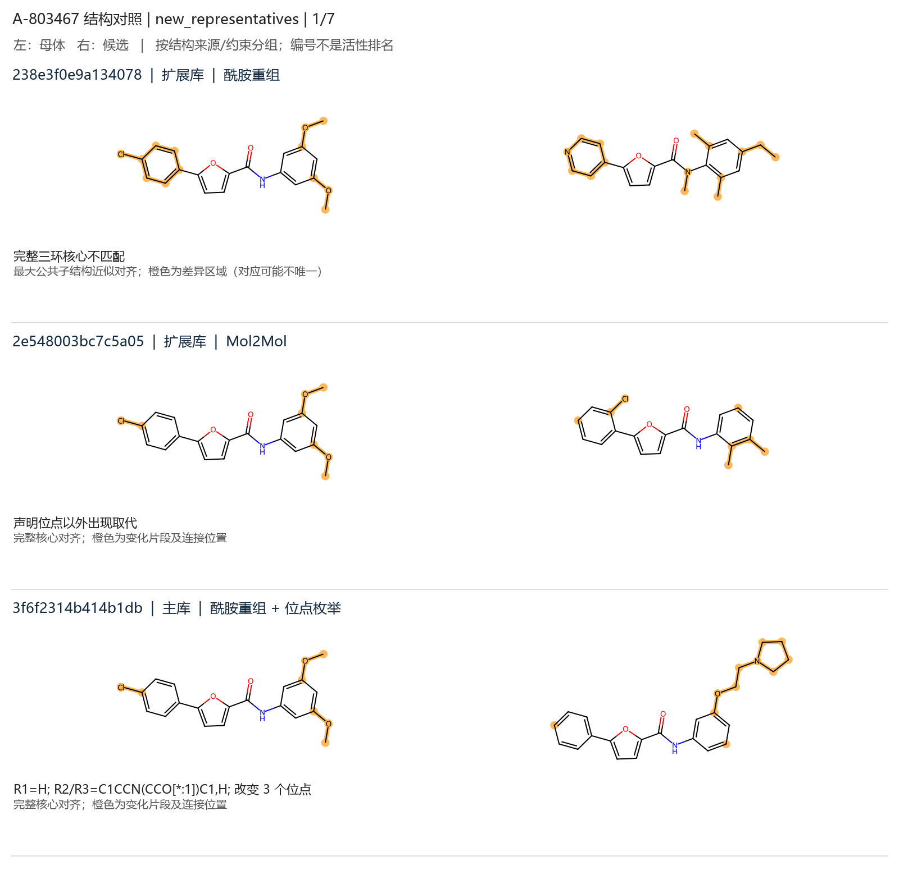

# A-803467 共享结果（2026-10-01）

**2,944 个非母体唯一候选**：1,543 主库、1,072 扩展库、329 系列外保留。旧 134 个结构全部保留，净新增 2,810 个。

这个目录是从真实运行中复制的结果快照，供队友查看和 CPU 复现。未按活性/docking 排序；原始运行中的绝对路径和软件哈希保留为历史元数据，不是队友电脑需要使用的路径。

| 内容 | 文件 |
|---|---|
| 完整候选总表 | [library/all_retained.csv](library/all_retained.csv) |
| 三层结构 SMILES | [主库](library/candidates.smi)、[扩展库](library/expanded_candidates.smi)、[系列外](library/outside_candidates.smi) |
| 本轮汇总与增量 | [summary.json](library/summary.json)、[分批收益](library/mol2mol_batch_growth.csv) |
| 三种方法的贡献 | [method_contributions.csv](library/method_contributions.csv) |
| 虚拟砌块和词表来源 | [virtual_blocks.json](library/virtual_blocks.json)、[vocabulary_evidence.csv](library/vocabulary_evidence.csv) |
| 初始完整记录及配置 | [baseline/](baseline/) |
| 五批原始模型样本、配置和清单 | [sampling/](sampling/) |
| 18 个成功输入状态、79 个三维构象 | [preparation_pilot/](preparation_pilot/) |
| 原始验证记录 | [library/validation.json](library/validation.json) |

1,000 条新模型采样包含重复、1 条母体和 1 条解析失败；全部保留。原始采样的唯一结构排除母体后为 351 个；不能把采样条数当不同候选数。三维代表共输入 19 个，1 个未指定立体化学而暂缓，未替它猜测构型。

## 代表结构对照图

每页 3 个候选，与母体并排比较；共 21 个新增代表，不是活性优选。

[第 1 页](review_first/new_representatives_01.png) · [第 2 页](review_first/new_representatives_02.png) · [第 3 页](review_first/new_representatives_03.png) · [第 4 页](review_first/new_representatives_04.png) · [第 5 页](review_first/new_representatives_05.png) · [第 6 页](review_first/new_representatives_06.png) · [第 7 页](review_first/new_representatives_07.png)



完整 247 页 PNG 和全库二维 SDF 可用以下命令从共享输入重建（仓库根目录、已安装项目依赖）：

```bash
python scripts/reproduce_shared_expansion.py --output outputs/team_reproduced --full-gallery
```

只检查结果包完整性：

```bash
python scripts/reproduce_shared_expansion.py --verify-only
```

脚本先核对 `sha256_manifest.json`，复现后逐项比较所有候选 ID、SMILES 和分类。推荐 RDKit 2026.3.6，与原批次一致；本地 CPU 即可，不需要模型权重或 GPU。环境安装及入口详见 [队友协作说明](../../docs/TEAM_QUICKSTART.md)。
